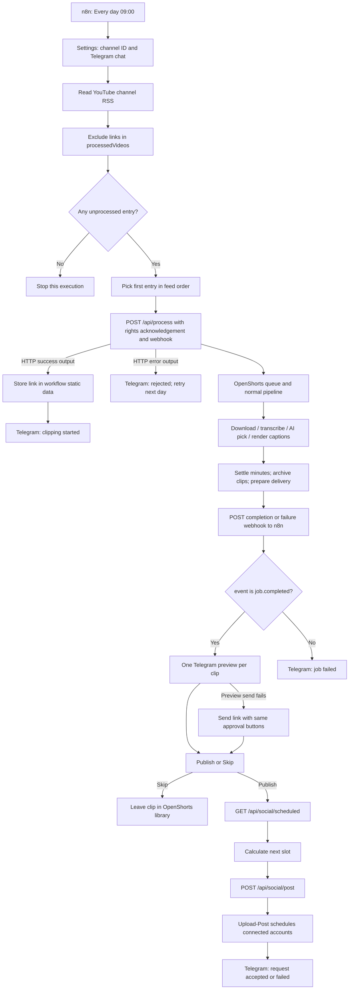
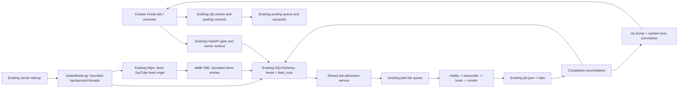
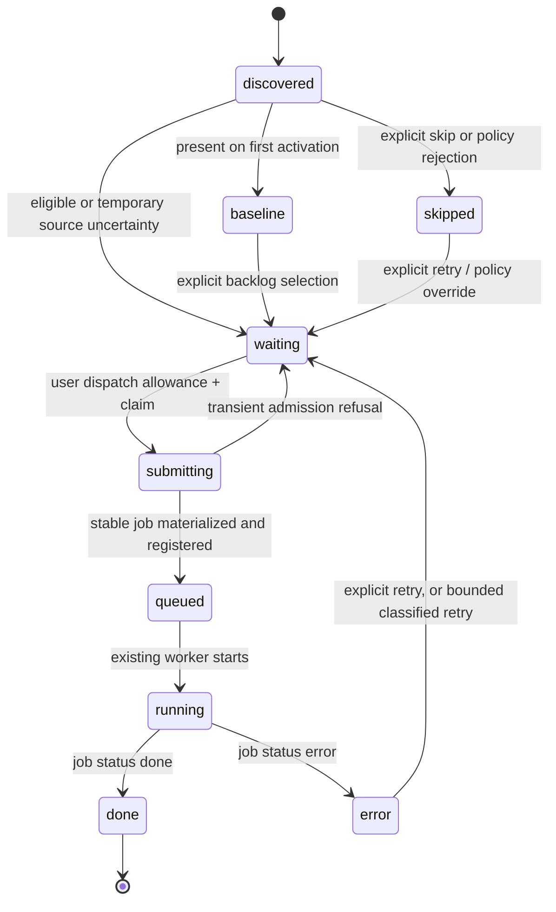

# YouTube feed automation for PeakCut

**Status: investigated design, not an implemented backend feature.** The accompanying
[interactive wireframes](youtube-feeds.html) use sample data and make no API,
RSS, download, AI, or publishing requests.

## Recommendation

Add a native **Feeds** tab to each creator, plus a cross-creator feed overview.
An always-on background worker reads a canonical YouTube channel feed, records new
video IDs, and submits eligible videos to PeakCut's existing fair queue. Finished
clips appear in the existing creator library for review.

**Reuse the installed stack. No new Python packages or external services are
required for the proposed MVP.** Use `httpx`, standard-library XML parsing,
SQLAlchemy, the existing background-thread pattern, yt-dlp metadata, the current
video pipeline, and plain HTML/CSS/JavaScript. Do not introduce n8n, Telegram,
Upload-Post, Redis, Celery, APScheduler, feedparser, or a YouTube API key.

YouTube itself remains the source, and clipping retains PeakCut's existing
configured AI provider and speech models. This does not make those existing
operations offline or remove their normal costs.

## 1. Sources and scope

The reference is the user-specified OpenShorts checkout, whose remote is
`y0geshdev/openshorts`, pinned at
[`353e8a4`](https://github.com/y0geshdev/openshorts/tree/353e8a4e18931b3bb68dbda583f871ee87def354).
PeakCut was inspected at
[`39c32a8`](https://github.com/y0geshdev/PeakCut/tree/39c32a878648619e981b57af608ba4571a82247f).
Source links below are pinned so subsequent changes do not alter the evidence.

| Source | What was traced |
| --- | --- |
| [n8n workflow JSON](https://github.com/y0geshdev/openshorts/blob/353e8a4e18931b3bb68dbda583f871ee87def354/examples/n8n/openshorts-content-machine.json) | Every executable branch, embedded JavaScript, settings, and node connections |
| [n8n README](https://github.com/y0geshdev/openshorts/blob/353e8a4e18931b3bb68dbda583f871ee87def354/examples/n8n/README.md) | Installation, credentials, webhook payload, approval, and documented limitations |
| [Submission endpoint](https://github.com/y0geshdev/openshorts/blob/353e8a4e18931b3bb68dbda583f871ee87def354/app.py#L6045-L6447) | Rights acknowledgement, URL checks, metering, quality gate, manifest, and queue |
| [Job execution and delivery](https://github.com/y0geshdev/openshorts/blob/353e8a4e18931b3bb68dbda583f871ee87def354/app.py#L3382-L3520) | Worker slot release, durable delivery stages, archive before webhook |
| [Completion webhook](https://github.com/y0geshdev/openshorts/blob/353e8a4e18931b3bb68dbda583f871ee87def354/app.py#L3989-L4084) | Clip links, signing, three delivery attempts, detached delivery |
| [Clipping pipeline](https://github.com/y0geshdev/openshorts/blob/353e8a4e18931b3bb68dbda583f871ee87def354/main.py#L2978-L3125) | Transcription, AI moment selection, cutting, framing, hooks, captions |
| [Social submission](https://github.com/y0geshdev/openshorts/blob/353e8a4e18931b3bb68dbda583f871ee87def354/app.py#L9496-L9610) and [scheduled list](https://github.com/y0geshdev/openshorts/blob/353e8a4e18931b3bb68dbda583f871ee87def354/app.py#L9991-L9998) | Owner checks, connected profile, Upload-Post scheduling |
| [Cloud Autopilot architecture](https://github.com/y0geshdev/openshorts/blob/353e8a4e18931b3bb68dbda583f871ee87def354/docs/architecture/autopilot.md) | A separate connected-account feature, not the RSS template |

This was source inspection, not a deployed n8n execution or a real YouTube,
Telegram, or paid OpenShorts processing run. Runtime behavior dependent on those
services remains unverified.

## 2. What OpenShorts actually implements

There are two different features:

| Feature | Discovery | Orchestration and memory | Review |
| --- | --- | --- | --- |
| **Content Machine example, the RSS reference** | Public YouTube channel RSS/Atom feed | n8n daily schedule and workflow static data | Telegram Publish/Skip buttons |
| **Cloud Autopilot** | OAuth-connected YouTube account media through Upload-Post | OpenShorts background loop, settings/runs database | Dashboard; optional automatic scheduling |

The RSS feature is an importable workflow example, **not a feed editor or native
RSS polling service inside OpenShorts**. Its daily RSS reads are polling; the
README's "no polling loop" refers to waiting for clip completion, which uses a
webhook instead of polling job status.

### End-to-end flow



### Discovery and submission, node by node

1. **Every day 09:00** uses n8n's schedule/timezone configuration, not an explicit
   timezone in this node. **Settings** supplies the channel and chat IDs.
2. **Channel RSS feed** reads
   `https://www.youtube.com/feeds/videos.xml?channel_id=UC...`. RSS discovery needs
   no YouTube API key.
3. **Pick next video** compares each item's `link` against global workflow static
   data `processedVideos`. It selects `fresh[0]`. There is **no explicit timestamp
   sort, age cutoff, duration filter, live/premiere filter, or Shorts filter**.
   "Newest first" relies on feed-reader output order.
4. The first execution can select an existing upload. This is not a
   "only uploads published after activation" design. One video is selected
   **per execution**; changing frequency or overlapping executions can defeat
   the documented one-video-per-day intention.
5. **Start OpenShorts job** sends `url`, `acknowledged: true`, `webhook_url`, and
   `webhook_secret`, authenticated with a Header Auth API-key credential.
6. OpenShorts handles source validation, rights, ownership, normal admission,
   metering and quality checks, persists a resume manifest, queues the job, and
   normally returns `{job_id, status: "queued"}`.
7. On the success output, **Mark video as processed** appends the selected link.
   It does not validate that the body actually contains an accepted `job_id`.
   In particular, the server has a quality-gate response path before enqueueing;
   a non-error response alone is not sufficient evidence of job creation.
8. Static data is saved by n8n for successful production executions, not editor
   test runs. A later node error can affect whether that execution's changes
   persist. It is not a transactional, per-video job claim.

### Completion, approval, posting, analytics

```mermaid
sequenceDiagram
    participant N as n8n
    participant O as OpenShorts API
    participant P as Video pipeline
    participant T as Telegram
    participant U as Upload-Post
    N->>O: POST /api/process (URL, callback, acknowledgement)
    O-->>N: job_id, queued
    Note over N: Remember URL on accepted HTTP branch
    O->>P: Run normal clipping job
    P-->>O: Completed clips or failure
    Note over O: Release compute slot; settle and archive
    O->>N: job.completed / job.failed webhook
    N->>T: Preview or link, Publish / Skip buttons
    T->>N: User callback pub|job_id|clip_index
    N->>O: GET /api/social/scheduled
    O->>U: Read profile's pending schedules
    O-->>N: scheduled_posts
    N->>O: POST /api/social/post with chosen UTC time
    O->>U: Multipart clip upload, async_upload=true
    U-->>N: Acceptance forwarded through OpenShorts
    Note over N,U: Accepted schedule is not confirmed publication
    N->>O: Weekly impressions and per-post metrics
    O-->>N: Analytics
    N->>T: Sunday digest
```

The server generates absolute clip URLs and, when archived in managed storage,
24-hour presigned download links. It signs the JSON bytes with HMAC-SHA256 when
a secret is supplied. Delivery checks the callback URL at submission and again
on each attempt, does not follow redirects, and has a 10-second timeout with
delays of 0, 10, and 60 seconds before its three attempts.

The n8n template's callback branch does **not** verify that signature. Its supplied
`"change-me"` secret is a placeholder, not secure configuration. Failure callbacks
send a message but do not remove the link from `processedVideos`. Retries of an
accepted job that later fails therefore require intervention.

The webhook sender marks `webhook_sent` before launching its detached delivery
task. There is no durable acknowledged webhook outbox in this code path; a process
exit or exhausted attempts can leave n8n without notification. Repeated callbacks
also have no workflow-level completion-message dedupe.

Telegram approval parses callback data and the originating chat. The template
does not explicitly compare that chat/person with a configured approval allowlist,
persist decisions, or disable buttons after use. Repeated approvals can submit
again. "Skip" only confirms the choice; it does not delete a clip.

Slot selection starts at now + 10 minutes, then advances to 24 hours after nearby
pending scheduled timestamps. This is a rolling gap, not a fixed daily local-time
slot. **Reading the shared queue and then posting is not an atomic reservation**:
two simultaneous approvals can read the same list and choose the same slot.
The inspected endpoint forwards to Upload-Post without a corresponding local
unique-slot transaction. Do not copy the comment claiming this cannot race.

The Sunday 18:00 branch fetches weekly impressions and per-post metrics, formats
counts and a best-post summary, then sends Telegram. It does not drive clipping.
No `/api/social/analytics` call is made by the executable JSON branch; its actual
requests are `/api/social/analytics/impressions` and `/api/social/analytics/posts`.

### Limitations to avoid carrying over

| Observed behavior | Consequence for PeakCut |
| --- | --- |
| Feed contains a finite recent window | "Back catalogue" means only entries returned now; older missed videos cannot be recovered from RSS alone |
| A URL string is the dedupe key | Normalize to canonical video ID; alternate URL forms should not produce duplicate jobs |
| Memory updated at submission | Separate discovery, durable submission, completion, and review states |
| All submission errors use the "out of minutes" branch | Report the actual reason; the workflow does not discriminate 402 from downtime or other rejection |
| "Paused" message, but no persistent pause flag | It retries next day; build a real pause control |
| No compare-and-claim around selection | Prevent overlapping checks from creating duplicate work |
| No bounded retry/history policy | Add visible retry time, attempts, manual retry, and dedupe retention |
| Approval and scheduled acceptance conflated with final publishing | Preserve PeakCut's actual posting state; do not label scheduled clips "published" |

## 3. Native PeakCut architecture and dependency reuse



| Component | Reuse / minimal addition |
| --- | --- |
| Network | Already-pinned `httpx==0.28.1`; one bounded client with conditional GET |
| Feed parsing | `xml.etree.ElementTree`, standard library; only YouTube Atom namespaces needed |
| Scheduling | `threading`, `time`, bounded executors, durable `next_poll_at`; borrow `live.py` lifecycle patterns |
| Persistence | Existing SQLAlchemy Core, SQLite/PostgreSQL, new tables in `db.py` |
| Metadata / source | Existing yt-dlp via `media.py`; narrowly expose channel ID and upcoming/live status |
| Processing | `jobs.py`, the per-user fair queue and existing pipeline; no new clipping engine |
| Review / publishing | Existing creator clip cards, posting queue and connected accounts |
| UI | Existing single-file app patterns; cached summaries in `/api/sync`, paginated detail endpoint |
| Notifications | Existing creator activity and in-app alerts; no messaging-service requirement |

Use a **dedicated feed loop**, not the current live `auto_watch` switch.
`auto_watch` means live stream recording. Upload watching must not start a live
recorder or depend on a browser being open.

Initial supported input: canonical channel ID, `/channel/UC...` URL, or canonical
YouTube feed URL. These all normalize to the channel ID; the server constructs the
feed URL. Add handle support only once the existing yt-dlp metadata wrapper
reliably resolves a handle to a channel ID. Never turn arbitrary URLs into a
general-purpose feed fetcher.

### Proposed defaults for review, not already-approved product decisions

| Setting | Recommendation |
| --- | --- |
| Polling | Every 30 minutes with jitter; check-now shares the same lock and rate limit |
| First activation | Record a baseline; process only subsequent uploads |
| Optional initial backlog | User explicitly selects up to 3 currently visible feed entries |
| Dispatch | At most 1 newly admitted feed video per user per rolling 24 hours; fair rotation between their feeds |
| Eligibility | Published public videos; defer live/upcoming/private-or-unavailable sources |
| Source length | Minimum 3 minutes by default, labelled "minimum video length", not a guaranteed Shorts detector |
| Analysis span | First 30 minutes using `range_start=0`, `range_end=1800` |
| Clip settings | Snapshot creator language, layout, captions, lengths, max clips at submission |
| Review | Review first; no automatic publishing for feed jobs in MVP |
| Catch-up | Discover pause/downtime uploads still in RSS, up to a proposed 7-day age window |
| Pause | Stop new submissions; existing jobs continue, existing clips remain |

**Important:** PeakCut's `range_end` limits analysis, not a hard bandwidth or disk
cap. The current pipeline can download the full video/audio before slicing it.
Do not claim the first-30-minutes option limits download size. Normal disk quota
checks still apply. Creator `min_score` is not currently inherited as a normal
video clip filter; do not advertise it as one without implementing that behavior.

Short videos and actual YouTube Shorts are not identical. A duration threshold is
the simple, dependency-free MVP. A dedicated Shorts exclusion needs a separately
verified classifier; do not rely on a `/shorts/` redirect heuristic as certainty.

## 4. Persistence, scheduling, and recovery

Two SQLAlchemy Core tables are sufficient. Use strings/epoch timestamps and
portable `sa.JSON`; do not copy OpenShorts' cloud ORM or require PostgreSQL JSONB.

### `feeds`

| Field | Purpose |
| --- | --- |
| `id`, `user_id`, `creator_id`, `channel_id` | Owner and creator association |
| `status` | `initializing`, `active`, `paused`, `removed`; errors are separate from user pause |
| `settings` | Validated policy only: interval, age window, source span, initial selection |
| `revision`, `created_at`, `baseline_at` | Concurrent edit check and baseline completion |
| `last_poll_at`, `next_poll_at`, `last_success_at` | Durable polling schedule and user-visible freshness |
| `etag`, `last_modified` | Conditional requests; keep last valid values |
| `lease_token`, `lease_until` | Compare-and-set ownership of a check |
| `failure_count`, `last_error_code`, `last_error` | Bounded, scrubbed operational detail |
| `dispatch_cursor` | Fair rotation between a user's feeds |

Unique `(user_id, channel_id)` means one automation per channel per owner. Return
the existing feed when a user adds a duplicate rather than silently attaching
it to another creator. A different owner may independently watch that channel.
Index active `next_poll_at` and owner/creator listing.

### `feed_runs`

| Field | Purpose |
| --- | --- |
| `id`, `feed_id`, `user_id`, `creator_id`, `video_id` | Stable origin; unique `(user_id, video_id)` |
| `source_url`, `title`, `published_at`, `discovered_at` | Canonical source and bounded display metadata |
| `state`, `reason_code`, `reason` | Auditable progress / baseline / skip / retry explanation |
| `job_id`, `options_snapshot`, `review_policy` | Stable job intent, inherited settings, review-first provenance |
| `attempt_count`, `next_attempt_at`, `lease_token`, `lease_until` | Retry and dispatch ownership |
| `submitted_at`, `finished_at` | Dispatch cap accounting and completion |

Keep completed, skipped, and deleted-job tombstones while the account exists.
Prune bulky event details, not identity keys. A bounded candidate list per feed
does not imply deleting dedupe keys when they fall out of RSS.



`done` is PeakCut's finished job status, not OpenShorts' `completed`. Review and
publishing belong to clip/post states, not a new copy of the job lifecycle.

### Poll loop

1. Start after `db.init()` and normal job recovery. In local mode initialize
   `auth.local_user()` before enumerating owners; do not hard-code `u_local`.
2. Claim due feeds with a conditional update that sets a fresh lease token.
   Fetch outside SQL transactions and release expired leases on recovery.
3. Under `ctx.as_user(uid)`, validate the feed is still active, the creator still
   exists, the owner is not disabled, and the revision/lease still matches.
4. Fetch bounded XML, parse supported entries, normalize video IDs and dates,
   and upsert identities transactionally. Never treat a malformed first response
   as a successful baseline.
5. On the first successful fetch, mark current entries baseline and selected
   backlog entries waiting in the **same transaction**, then activate.
6. On later fetches, insert new entries, keeping all known states. Explicitly
   sort dispatch candidates by publication time, oldest eligible first.
7. Fetch metadata only for bounded candidates when there is dispatch capacity.
   Apply source/live/length checks and shared admission before expensive work.
8. Record the next check/retry and invalidate the owner's cached summary.
   A 304 changes successful-check time but does not create new entries.

Proposed fetch limits: 10-second timeout, 1 MiB decoded body, 100 entries, bounded
title lengths, 4 concurrent feed requests, and no overlapping check for one feed.
Reject DTD/entity declarations before XML parsing; malformed/oversized documents
are visible errors, never "no new uploads". Stream and count decoded bytes rather
than trusting `Content-Length`. Keep the fixed HTTPS YouTube origin, reject
credentials/ports/unexpected query keys, and disable automatic redirect following.
Do not fetch embedded entry links or thumbnails; rebuild watch URLs from validated
video IDs. This narrow parser avoids needing a general feed library.

Use `ETag`/`Last-Modified` when offered. Treat 429 and 5xx/network failures with
bounded exponential backoff and jitter (proposed 5 minutes through 6 hours).
Honor reasonable `Retry-After`, capped by policy. Invalid configuration asks for
an edit. A temporarily missing/private source is deferred with an expiry, not
claimed forever as "processed".

### The critical job-creation crash window

PeakCut stores jobs in files but claims feeds in SQL. A SQL insert followed by
`jobs.create()` is **not atomic**, and `jobs.enqueue()` is not currently idempotent.
An idempotency key in the API response alone will not fix either problem.

```mermaid
sequenceDiagram
    participant D as Feed dispatcher
    participant S as Existing SQL database
    participant J as Job persistence / registry
    participant Q as Existing fair queue
    D->>S: Claim run + reserve stable job_id and settings
    S-->>D: Commit durable submission intent
    D->>J: Materialize prepared job using that job_id
    Note over J: Atomic job.json write; prepared is not runnable
    D->>S: Link materialized job and record accepted dispatch
    D->>J: Transition prepared to queued
    D->>Q: Register/enqueue once by job_id
    Note over S,Q: Restart reconciles intent, file, registry, queue
```

Minimal tightly coupled additions to `jobs.py`:

- Allow an internal reserved job ID and persisted origin/review policy; validate
  its format and owner. An existing matching job returns the same job rather
  than overwriting it. A mismatch is a surfaced consistency error.
- Add a non-runnable prepared state for feed intents; do not persist it as
  queued until linkage/admission is complete.
- Make queue registration idempotent by job ID across queued/running registries,
  under the existing queue lock. A retry uses a new attempt on the same logical
  run, not two active queue entries.
- Reconcile SQL intent and prepared/queued job files before startup resumes
  normal queue entries. A missing file after intent commit is materialized
  using the same ID; an existing file after link failure is linked, not recreated.
  Resolve deletion/pause before dispatch, not after enqueue.

Reserve the per-user daily allowance with the intent, release it only for
unmaterialized rejected intents, and serialize allowance checks with manual/feed
job admission. A reconciled accepted intent must retain its original timestamp.
Recover terminal jobs into run state without rerendering them.

This design targets PeakCut's current **single server process**. SQL claims can
guard overlapping feed workers, but the existing in-memory queue and file/post
registries do not become a safe distributed worker system merely by adding leases.
Multi-server processing is a separate scope; no Redis is needed for this MVP.

## 5. Admission, completion, and review-first guarantees

Extract the existing manual-job admission into a small shared service callable
by HTTP routes and background tasks. Preserve verification, owner/creator checks,
source allowlisting, YouTube backoff, required tools, throttling, per-user active
limits, and storage quota. Keep capacity check + materialization serialized by the
existing create lock. Do not call `jobs.create()` directly and bypass these guards.
Do not manufacture a browser session or make internal HTTP calls to emulate a user.

Use the existing queue's per-user fairness for all feed jobs. A separate feed
daily dispatch policy limits automation, but does not replace ordinary admission.
The current server's quota cache is not a reserved disk budget; avoid promising
concurrent jobs can never exhaust the drive.

Persist `origin: {type: "youtube_feed", feed_id, run_id, video_id}` and
`review_policy: "manual"` **before the job can run**. Resolve and snapshot creator
settings at admission so later edits do not silently alter an in-flight job.

**Required publishing change:** `posting.on_clip_ready()` currently posts whenever
the creator has autopost enabled and eligible accounts. For feed jobs with
`review_policy == "manual"`, it must not enqueue automatic posts, even when creator
autopost is enabled or changed later. Manual posting through the existing controls
is still allowed. Test this before showing a "review first" label.

For completion, add one small normal-job terminal-state notification and a
startup/periodic reconciliation pass. The callback updates feed history and
calls `ctx.bump()`; reconciliation repairs missed callbacks. An event alone is
not durable. No completion webhook, public callback endpoint, API key, Telegram
bot, or new notification platform is necessary.

## 6. API and UI contract

These routes are **proposals**, not endpoints available today.

| Route | Purpose |
| --- | --- |
| `POST /api/feeds/preview` | Validate canonical input and return bounded metadata/visible entries; no jobs |
| `POST /api/creators/{cid}/feeds` | Create the owner-scoped feed with explicit rights acknowledgement and bootstrap choices |
| `GET /api/feeds` | Bounded overview; optional creator/status filters |
| `PATCH /api/feeds/{fid}` | Validated settings/pause/resume with expected revision |
| `POST /api/feeds/{fid}/check` | Request one leased, rate-limited check; no daily-limit bypass |
| `GET /api/feeds/{fid}/runs?cursor=...&limit=25` | Paginated activity; links to existing jobs/clips |
| `POST /api/feeds/{fid}/runs/{rid}/retry` | Explicit retry, owner-scoped, dedupe/admission/cap still apply |
| `DELETE /api/feeds/{fid}` | Remove automation, retain run identity tombstones; no clip/job deletion |

Example creation request:

```json
{
  "channel_id": "UCxxxxxxxxxxxxxxxxxxxxxx",
  "acknowledged": true,
  "bootstrap": "new_only",
  "backlog_video_ids": [],
  "poll_minutes": 30,
  "range_end": 1800,
  "review_policy": "manual"
}
```

The placeholder channel ID is illustrative. Validate canonical IDs rather than
accepting this example literally. `user_id` is never accepted from the body.
Restrict backlog IDs to the server-validated preview/current channel feed.

Example overview item:

```json
{
  "id": "feed_example",
  "creator_id": "creator_example",
  "status": "active",
  "last_check": {"outcome": "ok", "new_videos": 0},
  "waiting_videos": 1,
  "clips_for_review": 3,
  "daily_allowance": {"remaining": 0, "reason": "daily_limit"},
  "review_policy": "manual",
  "revision": 4
}
```

Owner-scoped cached summaries may join `/api/sync`'s full changed response.
Its unchanged-token fast path must remain in-memory: no XML fetch, metadata
probe, or database scan on every page poll. Feed errors, dispatch, completion,
pause, review, and deletion all invalidate the correct owner's cache/token.

UI placement:

- **Existing shell:** keep Home, All videos, creator navigation, New creator,
  the AI usage footer, Settings and notifications. This is not a separate
  automation app. Admin navigation remains conditional; the mockup shows the
  default local-owner mode with sign-in off.
- **Creator tabs:** retain **Clips, Setup, Activity** in their existing order,
  then append **Feeds**. Keep the creator avatar, live status and Start/Stop
  recording action in the same topbar. Extend creator routing with
  `/app/creators/{cid}/feeds`; do not replace the current creator landing page.
- **Feeds:** explain upload watching versus live recording; add canonical
  input, preview, rights confirmation, new-only/backlog selection, last/next
  checks, allowance, and check-now/pause controls. Setup links here without
  replacing its live channels, live auto-record, clip settings or posting section.
- **Home:** keep the manual clipping hero, recording/clip/post metrics,
  activity chart, AI card, creator results and Post queue. Add a compact upload
  watching summary linking to each creator's Feeds tab.
- **Clips and All videos:** feed jobs join the existing video cards beside
  manual uploads and live recordings. Add Feed and Review first badges and a
  history link; retain the manual link/upload composer, Options, clip editor,
  Download, Copy post text and Post controls. Do not create a second library.
- **Activity:** add feed events alongside recordings, clips and posts.
  Detailed discovered/waiting/queued/running/done/error/skipped decisions link
  to the existing job and offer safe retry; no standalone Feed activity page.
- **Review and posting:** the existing Post flow uses connected accounts and
  the shared Home Post queue. Scheduling is not confirmed publication.
  Review-first feeds must bypass creator autopost even when it is enabled.

No new external font, icon, analytics, or JavaScript CDN is required. Reuse the
existing palette and styling, with no shadows or movement-on-hover.

## 7. File-by-file implementation plan

| File | Required change |
| --- | --- |
| `studio/db.py` | Add feed/run tables, portable constraints/indexes; update module description |
| New `studio/feeds.py` | Canonicalization, bounded XML/HTTP, leases, scheduling, discovery, dispatch, retry/reconciliation |
| New small `studio/admission.py` | Extract existing shared job guards and creation critical section; avoid duplicating routes' policies |
| `studio/jobs.py` | Stable internal IDs, origin/review snapshot, prepared recovery and idempotent queue registration, terminal notification |
| `studio/media.py` | Narrow channel-ID/upcoming metadata support via existing yt-dlp; normal download path unchanged |
| `studio/server.py` | Shared admission wiring, owner-scoped feed routes, startup/stop and cached sync summaries |
| `studio/creators.py` | Bounded feed activity entries/cache invalidation; keep live `auto_watch` separate |
| `studio/posting.py` | Enforce manual review policy at clip-ready autopost hook |
| `studio/account.py` | Coordinate creator/account deletion with claimed feed work; preserve or delete dedupe according to ownership lifecycle |
| `studio/config.py` | A small number of server-wide safety limits, not a second scheduler configuration system |
| `web/index.html` | Feeds tab, overview/setup/activity and existing clip links |
| Existing tests and project docs | Local/multiuser, recovery, network-free feed fixtures, clear semantics and usage |

New tables work with current `meta.create_all()`. That method does not migrate
existing table columns: avoid unnecessary column changes elsewhere, or explicitly
design migration handling. Creator ownership is stored in files, so no imaginary
creator-table foreign key should appear in the SQL schema.

Suggested implementation order:

1. Extract shared admission without changing manual behavior; prove queue/job
   reconciliation and review-policy guard.
2. Add tables, canonical input, bounded parser, polling and bootstrap tests.
3. Add durable dispatch/recovery, completion history and cleanup races.
4. Wire owner-scoped routes, cached sync, creator UI and review links.
5. Enable in a temporary-data instance, validate restart and real-feed behavior,
   then document operation. No automatic social posting in the first release.

## 8. Failure handling and acceptance criteria

| Case | Expected result |
| --- | --- |
| Feed empty on initial valid fetch | Valid empty baseline, explicit UI message; later entries eligible |
| Malformed XML / oversized / timeout | Error visible with retry; baseline and existing runs untouched |
| 304 response | Successful freshness update, no duplicate discovery |
| Same video via alternate URL / overlapping checks | One owner-scoped identity and one active job |
| Live/premiere/private/unavailable | Defer with reason and expiry; do not download or create repeated jobs |
| Source too short / older than catch-up window | Visible skip; explicit override needed |
| Jobs full / disk quota / YouTube bot pause | Keep waiting with accurate reason; normal admission still controls |
| Crash at each SQL/file/queue boundary | Recover the same job intent; no lost run or duplicate active queue entry |
| Completed job file but missed notification | Reconciliation marks run done and links existing clips |
| Pause during fetch/dispatch | Recheck lease/revision under admission lock; no new post-pause admission |
| Resume after downtime | Catch up only entries still available within chosen age policy; show RSS limitation |
| Creator removal races worker | Invalidate leases before deletion; block deletion when normal busy rules apply |
| Account disabled/deleted | No more fetch/dispatch; deletion joins current account cleanup |
| Individual job deleted | Keep dedupe tombstone; do not automatically clip the same video again |
| Feed removed/re-added | Preserve owner's video identities; explain previous-run history |
| Creator autopost enabled | Feed clips remain manual-review; ordinary manual/live behavior unchanged |

Use the existing `python tests/run.py` workflow **before and after any change to
`studio/`**, as required by PeakCut. Fake HTTP responses, time, metadata and
pipeline outputs; do not depend on YouTube availability, AI keys, n8n or Telegram.
Add focused cases to existing test files where practical, with parser/recovery
fixtures only as needed.

Acceptance checks must cover both sign-in-off local ownership and multi-user
isolation, SQLite and PostgreSQL-compatible SQL, baseline/new/backlog behavior,
daily allowance across feeds, conditional requests, retry expiry, stop/restart,
all submission crash windows, feed deletion races, and publishing suppression.
Changing one user's feed must not alter another user's sync result.

Do not call the feature complete based only on a happy-path RSS parse: the key
outcomes are one logical run per owner/video, correct recovery into the existing
queue, visible failure reasons, and no unapproved posting.

## 9. Interactive review mockups

Open [YouTube feeds wireframes](youtube-feeds.html) directly, or serve
the mockup directory with the Python standard library:

```sh
python3 -m http.server 8767 --bind 127.0.0.1 --directory plan/youtube-feed-automation
```

Then open `http://127.0.0.1:8767/youtube-feeds.html`.
No build step, package installation, real feed, or PeakCut server is needed.

The revised mockup recreates PeakCut's existing app frame and navigation,
with clickable **Home, All videos, two creators, New creator, AI usage, Settings
and notifications**. Creator tabs remain **Clips, Setup, Activity**, followed
by the proposed **Feeds (NEW)** tab. The initial view is Home, not a standalone
feed dashboard. New labels identify additions rather than existing UI.

Review paths:

1. **Home -> Manage feeds -> Feeds:** the existing dashboard surrounds a new
   upload-watching summary; preview/add a feed, choose baseline/backlog,
   check now, pause/resume, and inspect capacity/error states.
2. **Creator -> Clips / Setup / Activity / Feeds:** switch between the
   existing manual composer and library, live/clip/post settings, shared
   event history and proposed upload controls. Studio Conversations shows
   the existing recording player, hand-clip controls and Stop recording.
3. **Activity -> Open in Clips -> Post -> Home Post queue:** feed clips use
   the same library and connected-account posting path, while manual-upload
   and live-recording jobs remain visible in All videos.
4. **Settings:** existing AI, Connected apps, Speech models and Storage
   sections are retained. Profile/Security and Admin navigation are omitted
   only because the preview represents sign-in-off mode.

A scenario selector provides no-feed, active, waiting-for-space and
unavailable-feed states. Sample creator settings and posting decisions persist
only in page memory; Reset/reload clears them. All actions are safe sample
interactions: no feed request, file read, download, AI call, OAuth connection,
recording or publication occurs. The banner stays visible. Clip and live-player
placeholders are not real playable media. This is a faithful layout wireframe,
not a running copy of the production application; production files are unchanged.

Product choices to review before backend work: input convenience (canonical IDs
first versus handle resolution), polling cadence, daily dispatch cap, optional
backlog count, age window, and minimum source duration. They are recommendations,
not additional requirements attributed to the user.
